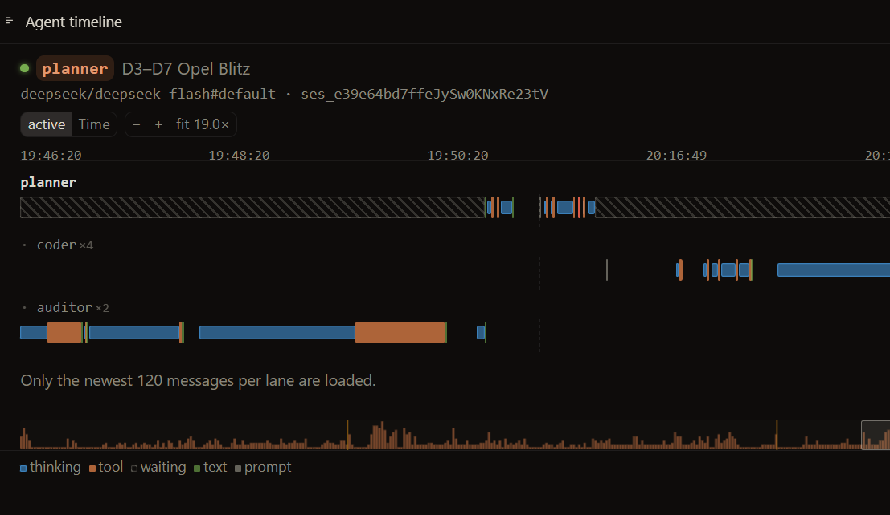

# Agent timeline

**OpenChamber shows you one chat at a time. This shows you the whole team.**

Planner, coders, auditors — every agent of a run on its own lane, all on one
time axis. You see what ran when, who was waiting for whom, and where the
twenty minutes went.



## What OpenChamber can't do

Subagent sessions are there, but they hide one by one behind *expand
subsessions*, each with its own transcript. There is no picture of the run as a
whole: which agents were active at the same time, which one blocked the others,
which one is still going.

That is the whole point of this extension. It draws every agent on its own
lane, several levels deep, subagents indented under the agent that spawned them,
and two sessions of the same agent as one lane (`coder ×4`).

## Reading it

| | |
|---|---|
| blue bars | tool calls — a burst of consecutive calls is one bar, click it for the list |
| thin blue | thinking |
| green | the answer text |
| hatched | waiting: for a subagent, or for you |
| amber line | a context compaction |
| grey line | a prompt |

The axis is *active time*: idle stretches over 15 s are compressed, so a turn
that mostly waited does not squeeze the work into a sliver. `Time` switches to
the real clock.

Zoom with `+` / `−`, ctrl+wheel, or by dragging; double-click a bar to zoom onto
it; `fit` shows the whole session. A chart opens on the **last 10 minutes** and
follows the newest end — a selected section stays where it is.

## Install

OpenChamber → **Settings → Extensions → Install**, paste this repository's URL
(or pick the folder). Grant `service` and `opencode` — both read-only — then open
**Agent timeline** in the right rail. The same view is available as a full page.

Requires OpenChamber 2.5.0+ (`apiVersion: 1`).

## How the timings are derived

`reasoning` and `tool` parts carry real timestamps. Everything else the service
works out in `service/main.js`:

- **text parts have no time** — they take the gap up to the moment the message
  finished streaming, never the end of a later tool;
- **handovers are clipped**: OpenCode emits the next tool call 0.3–4 s before it
  closes the previous part, which would otherwise claim two things ran at once;
- **running tools** end at "now", so the bar grows;
- **compaction** is a message with a single timestamp, so it is drawn as a
  marker rather than a span.

## Limits

The newest **120 messages per lane** are loaded (OpenCode caps a request at
200), so older turns are missing — the panel says so. The service is read-only:
sessions, messages, projects, events.

## Development

```bash
npm install
npm run build     # src/panel -> panel/ (esbuild, IIFE); index.html copied
npm run dev       # real service + iframe harness on 127.0.0.1:45997
```

`npm run dev` needs `~/.config/opencode/service.json` (OpenChamber writes it) and
OpenCode on `127.0.0.1:28894`. Handy parameters: `?session=<id>`, `?click`,
`?zoom=3`, `?font=2`, `?clock`.

`panel/` is committed on purpose: the host loads the build exactly as it sits,
and an install from a repository fails with `missing-build` without it. CI
rebuilds and fails if the committed output differs from the sources.

## License

MIT — see [LICENSE](LICENSE). Not affiliated with the OpenChamber project; it
talks to OpenChamber through the guest API and to OpenCode through the host's
loopback link.
