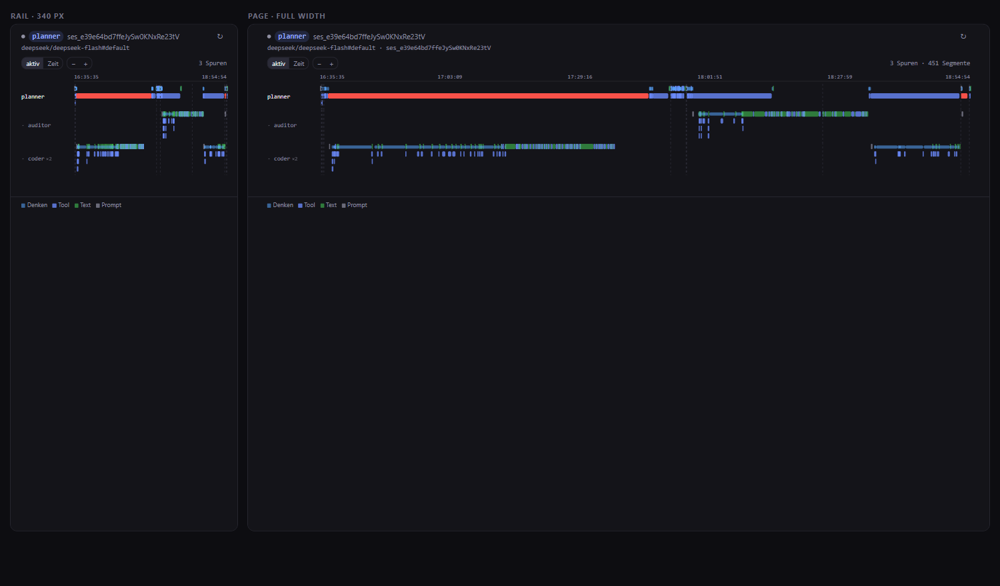

# Agent timeline

OpenChamber-Erweiterung: eine Schwimmbahn-Zeitleiste für den **gerade offenen Chat**.
Eine Spur pro Agent-Ebene, ein Balken pro Denk-, Tool- und Text-Segment, Klick öffnet die Details.



## Installieren

1. In OpenChamber: **Settings → Extensions → Install** und dort **den Ordner** `E:\Coding\Openchamber_team` wählen.
2. Die Erweiterung fragt zwei Fähigkeiten an: `service` (eigener Hintergrunddienst) und `opencode` (Lesezugriff auf Sessions). Beide freigeben.
3. Das Icon **Agent timeline** in der rechten Leiste öffnen. Über das Seitenleisten-Menü („Extension pages") öffnet sich dieselbe Ansicht als Vollbildseite.

Eine Ordner-Installation liest direkt aus diesem Ordner: nach `npm run build` und einem Reload im Panel ist jede Änderung live.

## Bedienen

| | |
|---|---|
| Spur | ein Agent-Level. Unteragenten rücken mit `·`-Präfix ein, die Wurzel steht oben. Zwei `coder`-Sessions derselben Ebene teilen sich eine Spur und stehen als `coder ×2` da. |
| Balken | Denken (dünn, blau), Tool (kräftig, blau / gelb = läuft / rot = Fehler), Text (grün), Prompt (grau, Strich). |
| Überlappung | Segmente, die zeitlich kollidieren, bekommen automatisch eine Unterzeile in ihrer Spur. |
| **aktiv** | Pausen über 15 s werden gestaucht, die Arbeit füllt die Breite. |
| **Uhrzeit** | lineare Zeitachse. |
| **Zoom** | `+` / `−` in der Leiste, Strg+Mausrad zoomt unter dem Zeiger, Ziehen verschiebt den Ausschnitt, Doppelklick auf einen Balken zoomt genau darauf. `fit` (oder Taste `0`) zeigt wieder die ganze Zeitleiste. |
| Klick | öffnet unten die Details: Agent, Session, Modell, Tokens, Dauer, Eingabe/Ausgabe. |
| `Esc` | schließt die Details. |
| ↻ | lädt neu, ohne den Dienst-Cache zu benutzen. |

Während irgendeine Spur arbeitet, fragt das Panel alle 1,5 s nach; im Ruhezustand passiert nichts.
Das gilt auch, wenn nur ein Unteragent im Hintergrund weiterläuft, während der Chat selbst schon still ist.

## Wie die Zeiten entstehen

`reasoning`- und `tool`-Teile bringen `time.created`, `time.ran`, `time.completed` mit — daraus wird exakt gezeichnet.
Zwei Sonderfälle löst der Dienst (`service/main.js`):

- **`text`-Teile haben gar keine Zeit.** Sie erben das Fenster zwischen dem Ende des vorherigen Teils und dem Moment, in dem die Nachricht fertig gestreamt war (`time.streamed`). Nie das Ende eines späteren Tools — sonst würde ein blockierendes Tool den Text über Minuten ziehen.
- **Laufende Tools** bekommen `jetzt` als Ende, der Balken wächst also mit.

## Grenzen

- Je Spur werden die letzten **120 Nachrichten** geladen (OpenCode erlaubt maximal 200 pro Anfrage). Ältere Turns fehlen; das Panel sagt es unten.
- Maximal **24 Spuren**, **4 Ebenen** tief.
- Der Dienst darf nur lesen: Sessions, Nachrichten, Projekte, Events. Alles andere beantwortet der Host mit `403 NOT_A_LISTED_READ`.

## Entwicklung

```bash
npm install
npm run build     # src/panel -> panel/ (esbuild, IIFE), HTML kopiert
npm run dev       # Harness im Browser, ohne OpenChamber-Neuinstallation
```

`npm run dev` startet den echten Dienst gegen dein lokales OpenCode und malt das Panel in einem einfachen iframe-Harness (`http://127.0.0.1:45997/`). Nützliche Parameter:

- `?session=<id>` — bestimmte Session (ohne: die zuletzt geöffnete)
- `?clock` — startet im Uhrzeit-Modus
- `?click` — öffnet einen Detail-Drawer

Der Harness braucht `~/.config/opencode/service.json` (schreibt OpenChamber beim ersten Start) und ein laufendes OpenCode auf `127.0.0.1:28894` (`OPENCODE_PORT` überschreibt).

## Struktur

```
package.json          Manifest (openchamber.contributes) + Skripte
icon.svg
src/panel/            Quelle des Panels (index.html, main.js) — nur hier editieren
panel/                Build-Ergebnis, wird installiert (nicht im Git)
service/main.js       Dienst: baut Spuren+Segmente, /health /timeline /detail
scripts/build.mjs     esbuild
dev/                  Harness + Dev-Server, nicht Teil des Pakets
```
